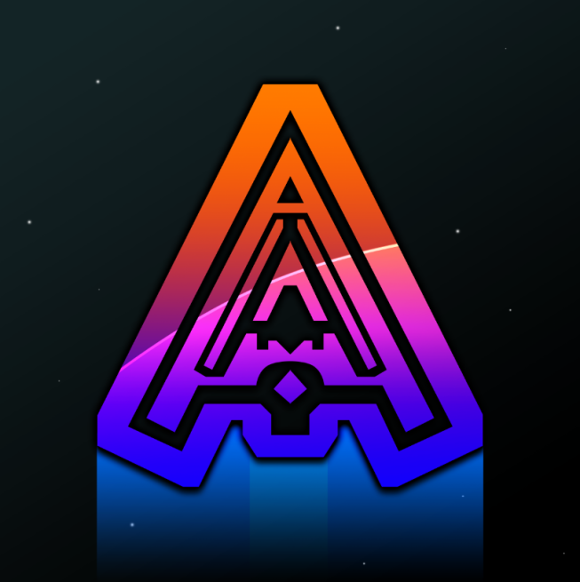
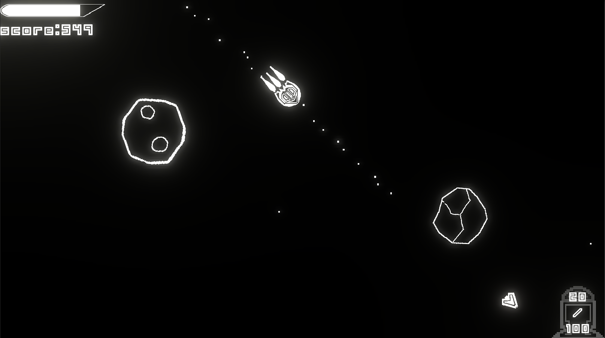
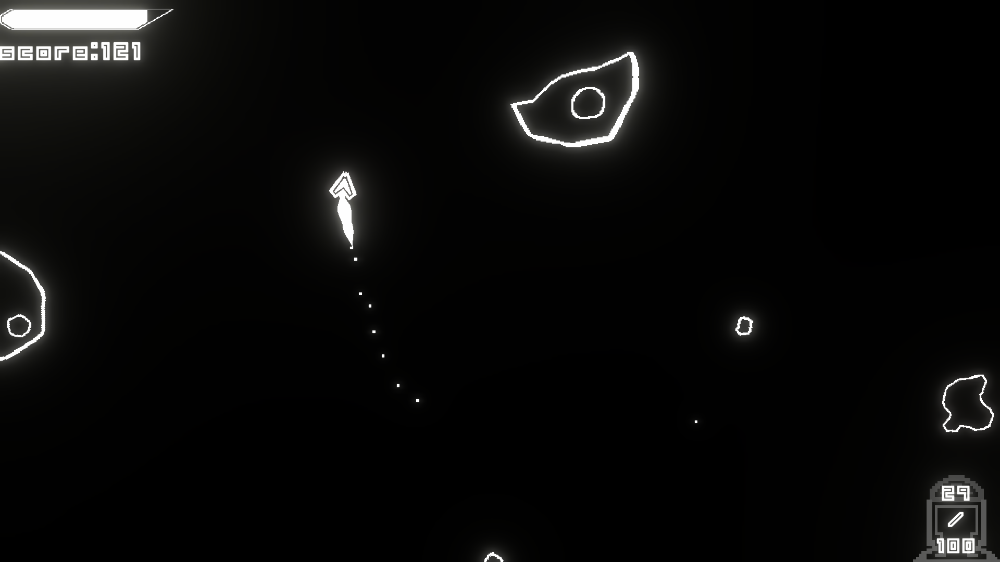
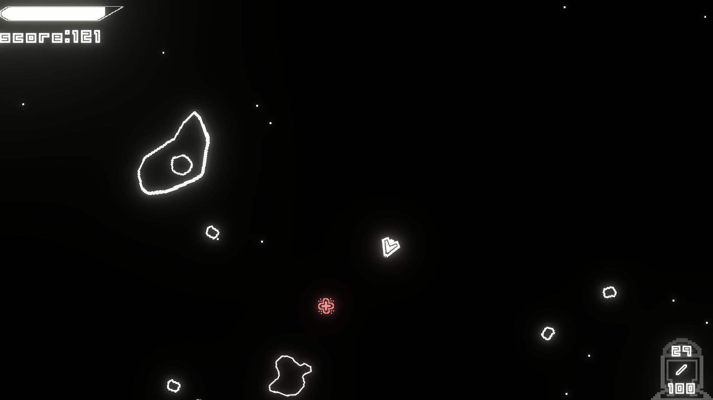
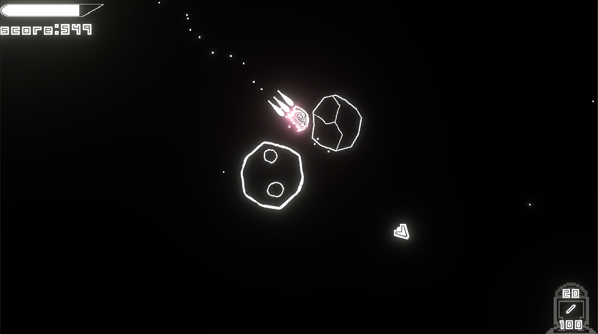
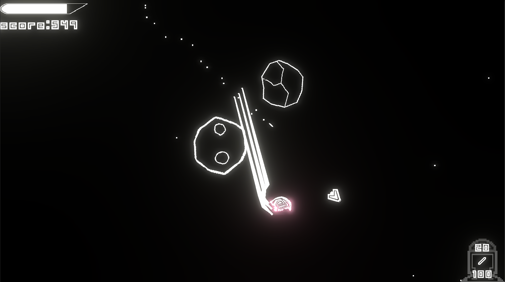

# Stellaroid (Sep 05, 2021)

A 2D Asteroids-style space shooter made in Unity. Fly a spaceship, blast asteroids and enemy ships, collect drops, and chase a high score.
Started around September 2021.

**Play it in the browser:** https://georgeenglezos.github.io/Stellaroid/ (also on [itch.io](https://judge-g.itch.io/stellaroid))

## Screenshots

| | |
|---|---|
|  |  |
|  |  |
|  | |

## Controls (desktop)

| Action | Keys |
|---|---|
| Thrust | W / Up Arrow |
| Rotate | A, D / Left, Right Arrow |
| Sprint | Left Shift |
| Shoot | Space |
| Switch weapon | E |
| Pause | Esc / P |

## Tech

- Unity 6000.6.4f1 (Unity 6)
- Universal Render Pipeline (URP) with 2D renderer and post-processing
- Cinemachine for the camera
- TextMesh Pro for UI text

## Project layout

- `Assets/Scripts/Spaceship`: player movement, weapons, collisions, radar
- `Assets/Scripts/Enemy`: enemy movement, weapons, radar
- `Assets/Scripts/Asteroids`: asteroid data and spawning
- `Assets/Scripts/Managers`: game state, UI, sound, object pooling, events
- `Assets/Scenes/SampleScene.unity`: main scene

## Running

Open the project folder in Unity Hub with editor version 6000.6.4f1, open `Assets/Scenes/SampleScene.unity`, and press Play.

## Web build

The browser version is built with the Web platform into `docs/`, which GitHub Pages serves. The page around the game (black background, controls and how to play) comes from the custom template in `Assets/WebGLTemplates/Stellaroid`.

## Credits

- Music: "Eternal Explorer" by Of Far Different Nature ([CC BY 4.0](https://creativecommons.org/licenses/by/4.0/))
- Laser sound: Murkje
- Cannon sound: GameSupplyGuy
- Explosion sound: Kronbits
- Pickup sound: GameSupplyGuy
- Font: "Unlearned BRK" by Brian Kent (ÆNIGMA Fonts)
